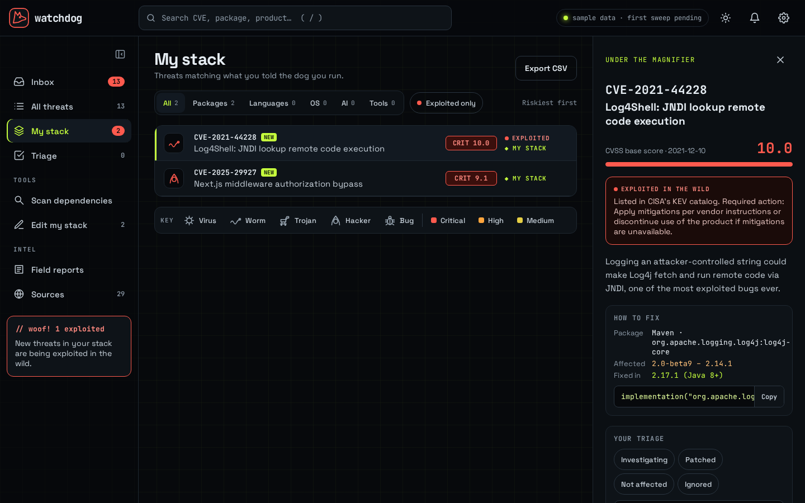
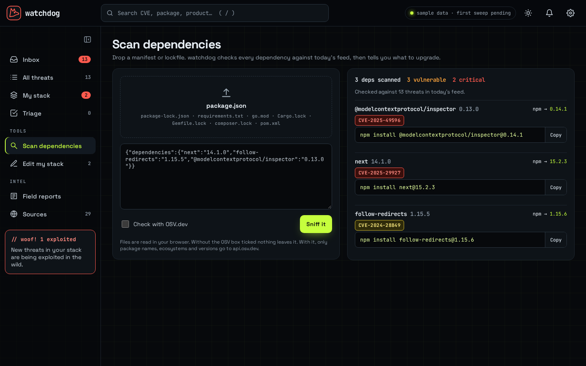
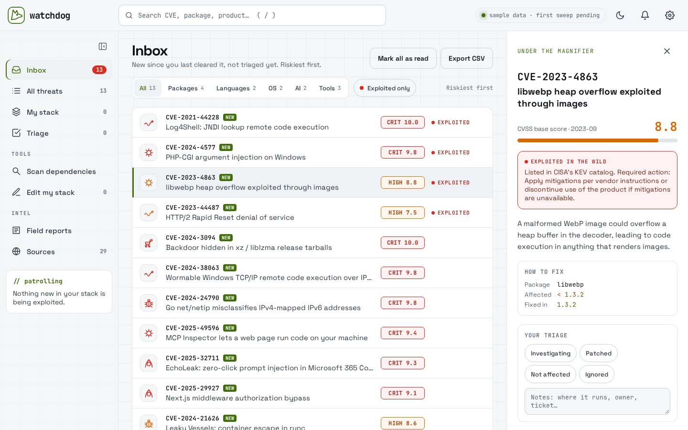

<div align="center">

<picture>
  <source media="(prefers-color-scheme: dark)" srcset="docs/images/watchdog.svg">
  
</picture>

# watchdog

[](https://github.com/tinesoft/watchdog/actions/workflows/ci.yml)
[](https://github.com/tinesoft/watchdog/actions/workflows/deploy.yml)
[](LICENSE)
[](https://astro.build)
[](#-install-it)

</div>

A static web app that tells you which public vulnerabilities affect the software you run. Twice a day a GitHub Action sweeps authoritative sources (CISA, GitHub Advisories, NVD, CERTs, vendors and security labs) and publishes the result. You tell the dog what you run, and it raises the alarm when something in your stack is being exploited. Everything you decide, your stack, triage and notes, stays in your browser.

```text
 watchdog          Search CVE, package, product…  ( / )        ● swept 2 h ago · next in 5h24   ☼  🔔  ⚙
 ┌────────────┐
 │ Inbox   13 │   CVE-2021-44228  NEW   Log4Shell: JNDI lookup remote code execution   CRIT 10.0  ● EXPLOITED
 │ My stack 2 │   CVE-2025-29927  NEW   Next.js middleware authorization bypass        CRIT 9.1   ◆ MY STACK
 │ Triage   0 │
 │ // woof! 1 │   Riskiest first: exploited, then yours, then by CVSS.
 └────────────┘
```

---

## 📸 Screenshots

### Your stack, ranked



### Scan dependencies



### Light theme



---

## ✨ Features

- 📥 **An Inbox that empties.** Threats that are new since you last cleared it and that you have not triaged, riskiest first. **Mark all as read** clears it.
- 🐕 **A dog that barks.** When a new threat in your stack is being exploited the dog barks, the count turns red and a card says so. Otherwise it patrols.
- 🎯 **Your stack.** Quick-add presets, an autocomplete over about 70 packages and products, or anything you type. Matching is by whole word in a threat's title, product and package.
- 🔥 **Ranked by risk.** Exploited first, then yours, then CVSS. Filter by category (packages, languages, OS, AI, tools), **Exploited only** and search.
- 🔎 **A detail panel.** CVSS bar, what is affected and what fixes it, the CISA required action for exploited threats, the advisories that cover it, and a copyable install command for npm, PyPI, Maven and Go.
- ✅ **Triage with notes.** Investigating, Patched, Not affected or Ignored, plus a note per threat. Triaged threats leave the Inbox.
- 🧰 **Scan dependencies.** Drop `package.json`, `package-lock.json`, `requirements.txt`, `go.mod`, `Cargo.lock`, `Gemfile.lock`, `composer.lock` or `pom.xml`. The file is read in your browser and checked against today's feed.
- 📰 **Field reports.** Research from security labs and news outlets, linked to the threats it covers, with a filter per lab.
- 🌐 **Sources.** Every source watchdog knows, in five groups, with the result of its last sweep. A source that fails keeps its last result and is marked as failed.
- 🔔 **Alerts while it is open.** A bell with the new threats in your stack, optional browser notifications, one per new threat, and an RSS feed for when watchdog is closed.
- 🔗 **Hand-offs.** **Open GitHub issue** pre-fills a new issue on a repository you choose. **Copy as Markdown**, **Copy link** and **Export CSV** do what they say. Nothing is posted for you.
- 📴 **Works offline.** Installable, and after one visit it opens with no network, showing the last sweep.
- 🌗 **Dark and light.** A collapsible sidebar, keyboard shortcuts (`/` focuses search), reduced-motion support and every state also written as a word, not colour alone.

---

## 📦 Install it

watchdog is a web app at **https://tinesoft.github.io/watchdog/**. Nothing to install, but you can add it to your device:

- **Chrome, Edge, Brave:** the install icon in the address bar, or the menu → **Install watchdog**.
- **Safari on iOS:** Share → **Add to Home Screen**.
- **Firefox:** use it in a tab. Firefox on desktop does not install web apps.

After the first visit it works offline. When a new version is ready, a small prompt asks you to reload. It never reloads on its own.

---

## 🚀 Usage

### Tell the dog what you run

Open **Edit my stack**, tick the presets you use or type anything else, and press Enter. **My stack** then lists the threats that match, and the Inbox and the dog react to them. **Add to my stack** in a threat's detail panel adds its package in one click.

### Triage

Open a threat and pick a status. Statuses and notes are yours: they are never part of the collected data. **Triage** lists everything you have acted on.

### Scan a project

Open **Scan dependencies**, drop a file or paste its contents, and press **Sniff it**. Each vulnerable dependency shows the version to move to and the command to run. Ticking **Check with OSV.dev** also asks [OSV.dev](https://osv.dev) about every dependency, which finds more but sends package names, ecosystems and versions to `api.osv.dev`. It is off by default.

### Alerts

Open the bell, turn on **Browser alerts** and choose a level: **Exploited only**, **Critical or exploited**, or **Anything in my stack**. The page cannot notify you while it is closed. For that, subscribe to the RSS feed at `/watchdog/feed.xml`, which lists the newest exploited and critical threats.

### How threats are ranked

| Signal                                                       | Weight    |
| ------------------------------------------------------------ | --------- |
| Exploited (listed in CISA's Known Exploited Vulnerabilities) | 100       |
| Mine (matches your stack)                                    | 30        |
| CVSS base score                                              | score × 5 |

### The icons

Threat types come from keywords and CWE ids, and are a hint rather than a verdict: **virus** (runs code), **worm** (spreads or floods), **trojan** (arrives in disguise), **hacker** (gets past a check) and **bug** (anything else). Severity bands are CVSS 9.0 and up critical, 7.0 and up high, below that medium.

---

## ⚙️ Settings

| Setting               | What it does                                                                                  |
| --------------------- | --------------------------------------------------------------------------------------------- |
| Theme                 | Dark or light. Starts from your system theme.                                                 |
| Repository and labels | Where **Open GitHub issue** opens its pre-filled issue, as `owner/repo`, and the labels on it |
| Export JSON           | Downloads your stack, triage, notes and settings                                              |
| Import JSON           | Loads such a file, keeping only fields it understands                                         |
| Reset everything      | Erases all of it from this browser                                                            |

---

## 🔒 Data and privacy

- **What lives where.** Your stack, triage, notes and settings live in this browser's `localStorage`. There is no account and no server that sees them. They do not sync between devices: use **Export JSON** and **Import JSON** to move them.
- **What watchdog fetches.** Only its own files from the same origin: the app, the sweep's data and the feed. The one exception is **Check with OSV.dev**, which you turn on yourself.
- **Issues.** **Open GitHub issue** only builds a link. You post, or not, on github.com.
- **Untrusted text.** Everything that comes from a feed is escaped before it is shown, and only `http` and `https` links are rendered as links.
- **CSV.** Exported cells that start with `=`, `+`, `-` or `@` are prefixed so a spreadsheet does not run them as formulas.

---

## 🌍 Where the data comes from

The sweep (`pnpm nx collect web`) merges these into one list of threats, and each source's result is shown on the Sources page.

| Group             | Collected                                                                       | Listed, link only                                       |
| ----------------- | ------------------------------------------------------------------------------- | ------------------------------------------------------- |
| Government / CERT | CISA KEV, NIST NVD, CERT-FR                                                     | CERT-EU, CSSF, CIRCL                                    |
| Vendor            | Microsoft MSRC, Spring, Jenkins, Node.js                                        | Oracle, OpenJDK, NGINX, Palo Alto Networks, Sonar       |
| Advisory database | GitHub Advisory Database                                                        | OSV.dev (used live by Scan), Snyk, Docker Scout, GitLab |
| Security vendor   | Kaspersky, ESET, Sophos, Sonatype, Microsoft Security Blog, Google Project Zero |                                                         |
| Security news     | BleepingComputer, The Hacker News, SecurityWeek                                 |                                                         |

Link-only sources have no usable public feed, or block automated clients. They stay on the Sources page so the list is honest about what is and is not collected.

---

## ⚠️ Limits

- **Alerts need the page open.** A static site cannot receive push messages. Use the RSS feed for alerts while it is closed.
- **A window, not a history.** The data covers the last 90 days of high and critical advisories, new critical NVD entries from the last 30 days, and the exploited threats the last sweep already knew. Older threats drop out. Your triage of a threat that left the window stays in your browser but the threat is no longer listed.
- **Matching is by name.** A stack entry matches a whole word in a threat's title, product or package. It does not know what version you run, except in **Scan**, which does.
- **Threat type and category are heuristics.** They come from keywords and CWE ids, with a small hand-curated file for notable CVEs.
- **A threat with no score waits.** One that no source has scored cannot be ranked, so it appears once a later sweep finds a score.
- **Twice a day.** Sweeps run at 07:00 and 14:00 UTC (GitHub cron has no time zone), so the newest hours can be missing.
- **Not a scanner for your infrastructure.** It reads public advisories and the files you give it. It does not see your servers.

---

## 🛠️ Development

An [Nx](https://nx.dev) workspace with pnpm and one Astro app written in vanilla TypeScript. Open the repository in the dev container, or use Node 24.

```sh
pnpm install
pnpm dev     # http://localhost:4321/watchdog/, on seed data
pnpm check   # lint, typecheck, test, build
```

The layout, the Sweep, the workflows and how releases work are in [`CONTRIBUTING.md`](CONTRIBUTING.md). The original plan is in [`docs/design/plan.md`](docs/design/plan.md).

---

## 🤝 Contributing

Contributions are welcome. Read [`CONTRIBUTING.md`](CONTRIBUTING.md) first: branches, Conventional Commits, the checks to run and how to add a source. Use the words in [`GLOSSARY.md`](GLOSSARY.md).

---

## 📄 License

[MIT](LICENSE) © 2026 Tine Kondo.
